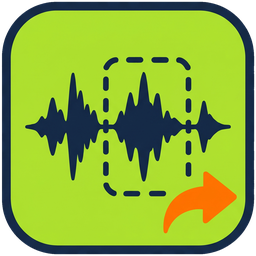
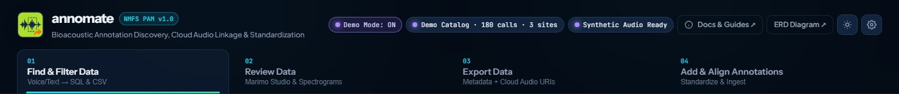
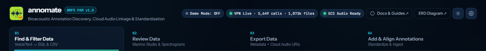
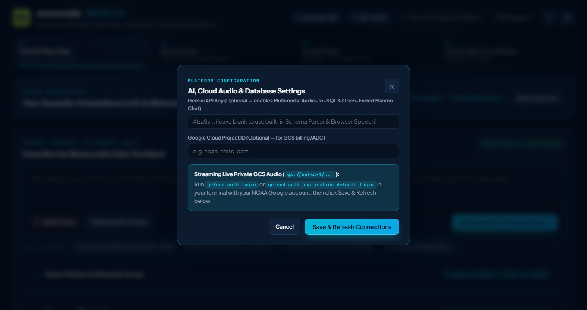
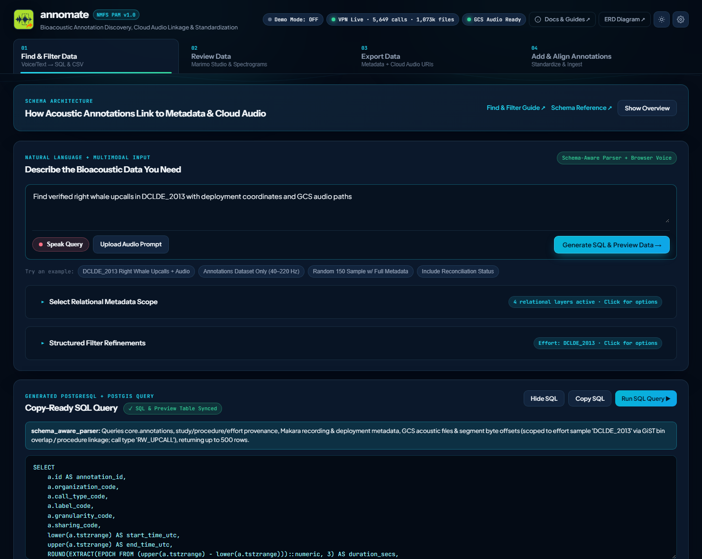
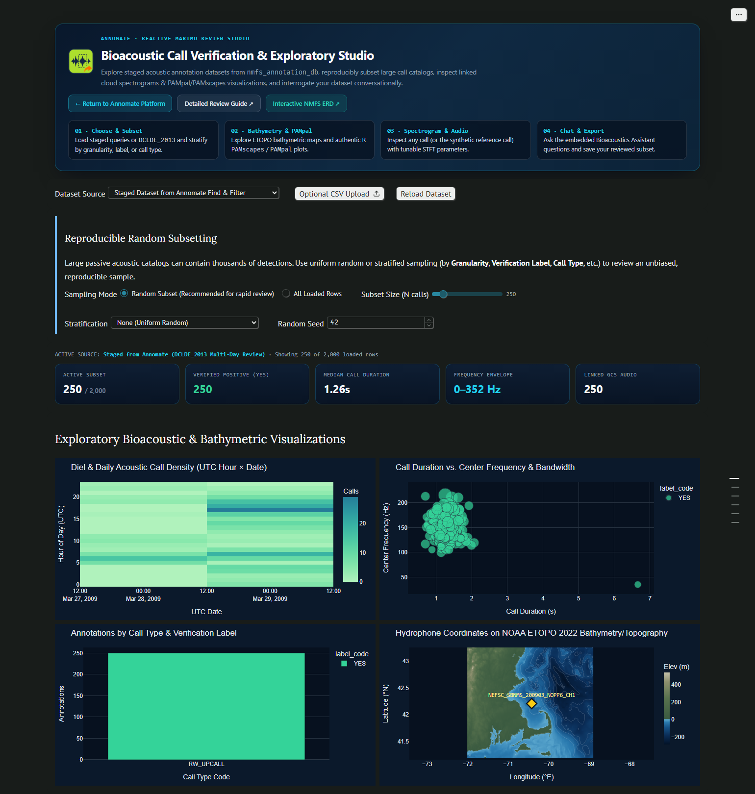
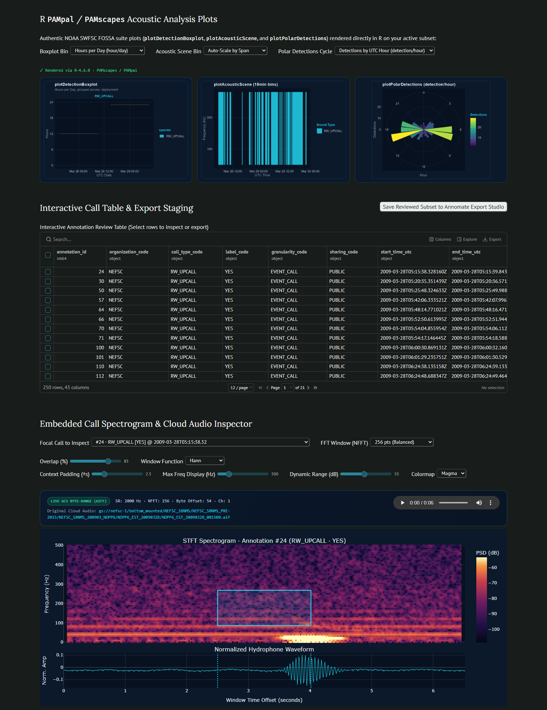
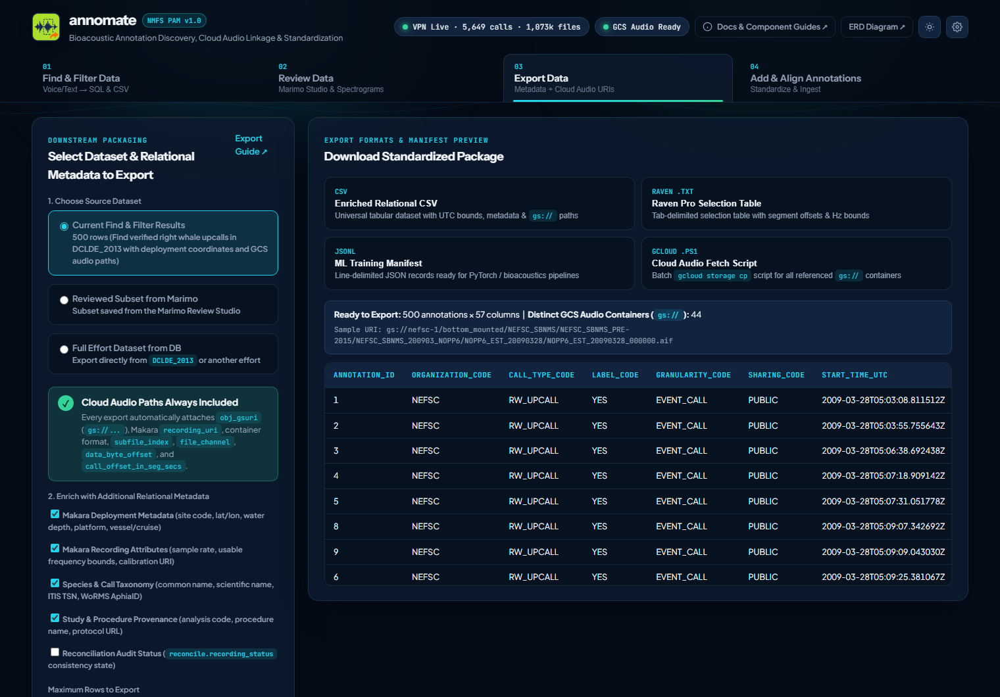
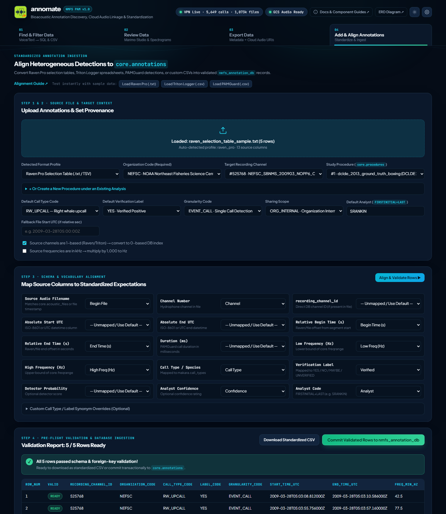

<p align="left">
  
</p>

# annomate

**Bioacoustic Annotation Discovery, Cloud Audio Linkage, Interactive Review & Standardization Platform**

**annomate** helps passive acoustic monitoring (PAM) scientists and analysts **find**, **review**, **export**, and **standardize** acoustic call annotations—connecting detections in NOAA NMFS's `nmfs_annotation_db` directly to authoritative **Makara** deployment metadata and original audio recordings in **Google Cloud Storage (`gs://`)**.

<br clear="left"/>

---

## How to Start Annomate (No Command Line Experience Needed!)

You do **not** need to know how to use a terminal or command line to run **annomate**—and you can start in **Offline Demo Mode** right away even if you do not have NOAA VPN or Google Cloud access yet!

### Trying It Out First? Use Offline Demo Mode (Zero VPN or Cloud Setup!)
If you are giving a live presentation, working on a plane/ship without internet, or haven't set up your NOAA VPN / Google Cloud credentials yet:
- **Option A — Double-click `Start_Annomate_Demo.bat`** in the `annomate` folder in Windows File Explorer. Your browser opens straight into **Demo Mode** with a built-in multi-day catalog of **180 bioacoustic calls across 3 hydrophone sites**, interactive filtering, bathymetry & `PAMpal` plots, **playable synthesized call audio**, exports, and safe simulated database commits!
- **Option B — Toggle Anytime Inside the App:** Even if you launched normally, you can click the **`Demo Mode: OFF / ON`** pill in the top header bar at any time to switch between Live Cloud Mode and Offline Demo Mode with one click:



---

### Full Live Mode (Connected to NOAA VPN & Google Cloud)

#### Step 1: Connect to the NOAA VPN
Because the production annotation database (`nmfs_annotation_db`) is hosted on an internal NOAA network, make sure your **Cisco AnyConnect / NOAA VPN** is connected first—the same way you connect to check internal NOAA websites.

---

### Step 2: Double-Click `Start_Annomate.bat` in File Explorer
1. Open **Windows File Explorer** and navigate to the `annomate` folder (`Documents\GitHub\annomate`).
2. Double-click **`Start_Annomate.bat`** *(in Windows, it may appear simply as `Start_Annomate` with a gear/window icon)*.
   - *Note:* If Windows shows a blue "Windows protected your PC" prompt the very first time, click **More info** → **Run anyway**.
   - On the **very first launch**, if the local Python environment hasn't been created yet, the launcher sets it up automatically (this takes 1–2 minutes only once).
3. A small dark launcher window will appear, and after about 3 seconds **your web browser will automatically open to http://127.0.0.1:8000**.
4. **Keep that small launcher window open (you can minimize it)** while you work in Annomate. When you are finished for the day, simply close (`✕`) that launcher window to shut Annomate down cleanly.

> **First-Time Database Password Check:** If this is a brand-new clone of the repository from GitHub, check that a `.env` file exists in the `annomate` folder with the database password filled in (you can right-click `.env` → **Open with** → **Notepad** to check; ask Shannon or Dan if you need the credentials).

---

### Step 3: Check the Status Lights at the Top of the Screen

Once your browser opens **annomate**, glance at the status badges in the top header bar:



- **`🟢 VPN Live · 5,649 calls · ...`**: You are connected to `nmfs_annotation_db` over the NOAA VPN! *(If this dot is orange and says `DB Offline`, reconnect to the NOAA VPN and refresh your browser.)*
- **`🟢 GCS Audio Ready`**: You are signed in to Google Cloud Storage and can stream & listen to live hydrophone audio directly from the cloud!
- **`🟠 GCS Auth Needed`**: You can still search, filter, review charts, and export data—but to stream **live private audio** for spectrograms, complete the one-time Google sign-in in **Step 4** below.

---

### Step 4 *(One-Time Setup)*: Sign In to Google Cloud Audio & Optional AI Settings

If the top bar says **`🟠 GCS Auth Needed`**, follow these 4 clicks to sign in with your NOAA Google account:

1. Press the **Windows key** (`⊞`) on your keyboard, type **`PowerShell`**, and click **Windows PowerShell** to open a window.
2. Copy and paste this single line into that window and press **Enter**:
   ```powershell
   gcloud auth login
   ```
3. Your web browser will automatically open a Google Sign-In page—click your **`@noaa.gov` account** and click **Allow**. *(You can close the PowerShell window afterward!)*
4. Back in **annomate**, click the **Gear icon (`⚙`)** in the top-right corner and click **Save & Refresh Connections**:



> **Optional Gemini AI Key:** Voice dictation and smart SQL generation work out of the box with no key required. If you have a Google `GEMINI_API_KEY` and want raw voice-memo-to-SQL and open-ended AI chat in the review notebook, you can paste it into this same **Settings (`⚙`)** window anytime.

---

## Visual Tour of the Four Workspaces

Use the four numbered tabs across the top of **annomate** to move through your workflow:

### `01` · Find & Filter Data
1. **Type or speak** what bioacoustic data you need in plain English (or click one of the example chips, such as `DCLDE_2013 Right Whale Upcalls + Audio`).
2. *(Optional)* Click **`▸ Select Relational Metadata Scope`** to choose between **Annotations Only** or joining deployment, recording, study, and cloud audio columns. Click **`▸ Structured Filter Refinements`** to filter by Effort, Organization, Call Type, **Granularity Code** *(hover over options to read definitions)*, Label, or Frequency.
3. Directly below, **Copy-Ready SQL Query** updates automatically as you change selections—click **Copy SQL** to paste into R/Python, **Hide SQL** to tuck the code away, or **Generate SQL & Preview Data →** to run the search.
4. Once your results appear, choose **Download CSV File** or **Review in Marimo Notebook →** in the green banner!



---

### `02` · Review Data (Marimo Studio, Bathymetry, `PAMpal` & Spectrograms)
Clicking **Review in Marimo Notebook →** (or opening Tab `02 · Review Data`) launches an interactive **Marimo** review notebook at **http://127.0.0.1:2718**:

- **Random & Stratified Subsetting:** Use the slider and **Stratification** dropdown (by Granularity, Verification Label, Call Type, Recording, etc.) with a **Random Seed** so large datasets are easy and reproducible to inspect.
- **Exploratory & Bathymetric Maps:** View diel UTC hour × date call density, duration vs. frequency scatter plots, label breakdowns, and **hydrophone coordinates overlaid on NOAA ETOPO 2022 bathymetry & topography**:



- **Authentic R `PAMpal` / `PAMscapes` Plots:** Automatically renders `plotDetectionBoxplot`, `plotAcousticScene`, and `plotPolarDetections` when R (`PAMscapes` / `PAMpal`) is installed locally.
- **Embedded Call Spectrogram, Audio Player & Data Chatbot:** Pick any call (or select **`★ SYNTHETIC REFERENCE CALL`** at the top of the dropdown), adjust `NFFT`, `Overlap %`, `Window`, `Padding`, `Max Hz`, `Dynamic Range`, and `Colormap`, press **Play (`▶`)** to listen to the call streamed directly from Google Cloud Storage, and ask questions in the **Bioacoustics Data Explorer Chatbot** at the bottom:



---

### `03` · Export Data
Package your search results, your reviewed Marimo subset, or an entire effort dataset (`DCLDE_2013`) with additional **Makara** deployment/recording metadata and species taxonomy—always including exact **`gs://` audio file paths and byte offsets**. Download with one click as:
- **Enriched Relational CSV**
- **Raven Pro Selection Table (`.selection.txt`)**
- **ML Training Manifest (`.jsonl`)**
- **Cloud Audio Fetch Script (`gcloud storage cp` `.ps1`)**



---

### `04` · Add & Align Annotations
Standardize annotation tables from **Raven Pro (`.txt`/TSV)**, **Triton Logger / Remora (`.xls`/`.xlsx`/`.csv`)**, **PAMGuard**, or **custom CSVs** into the `nmfs_annotation_db` schema:
1. **Step 1 & 2:** Drag and drop your file (or click one of the **Load Sample** buttons at the top right to test!) and choose your Organization, Recording Channel, and Study Procedure.
2. **Step 3:** Verify or adjust the auto-matched column dropdowns directly below.
3. **Step 4:** Click **Align & Validate Rows ▶** to check every row pre-flight, then **Download Standardized CSV** or **Commit Validated Rows to `nmfs_annotation_db`**.



---

## Detailed Guides & Helpful Links

When Annomate is running, click **`Docs & Component Guides ↗`** in the top bar (http://127.0.0.1:8000/guide), or open any guide directly in [`docs/`](docs/):

- **[00 · Quick Start & Daily Setup](docs/00_QUICKSTART_AND_OVERVIEW.md)**
- **[01 · Find & Filter Data Guide](docs/01_FIND_AND_FILTER_GUIDE.md)**
- **[02 · Marimo Review Studio & Spectrogram Guide](docs/02_MARIMO_REVIEW_STUDIO_GUIDE.md)**
- **[03 · Export Studio & Cloud Audio Guide](docs/03_EXPORT_STUDIO_GUIDE.md)**
- **[04 · Add & Align Annotations Guide](docs/04_ADD_AND_ALIGN_ANNOTATIONS_GUIDE.md)**
- **[NMFS Database & Schema Reference](docs/ANNOTATION_DATA_GUIDE.md)**
- **Interactive NMFS Database ERD & System Diagram** *(requires NOAA Google login)*:  
  **https://anndb-frontend-app-948464146942.us-east4.run.app/**

> **Need Additional Recordings Crawled?** Because NOAA's GCS archive uses Autoclass storage tiers, only whitelisted/Standard-tier recordings are currently indexed in `nmfs_annotation_db`. If a recording you need does not show audio files yet, **ask Dan** to add it to the crawler whitelist.

---

## For Command-Line / Developer Users *(Optional)*

If you prefer launching from PowerShell, Positron, or VS Code instead of double-clicking `Start_Annomate.bat`:

```powershell
# Start Annomate Web App (http://127.0.0.1:8000) and auto-open browser:
.\run_annomate.ps1

# Open the Marimo Review Notebook in full Python code-edit mode:
.\.venv\Scripts\python.exe -m marimo edit .\notebooks\review_studio.py --port 2718

# Run the automated test suite:
.\.venv\Scripts\python.exe -m unittest discover -s .\tests -v
```
